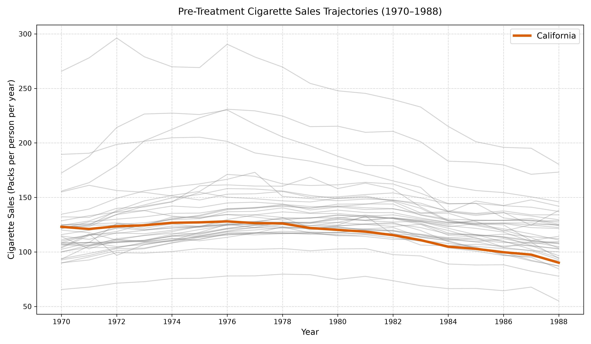
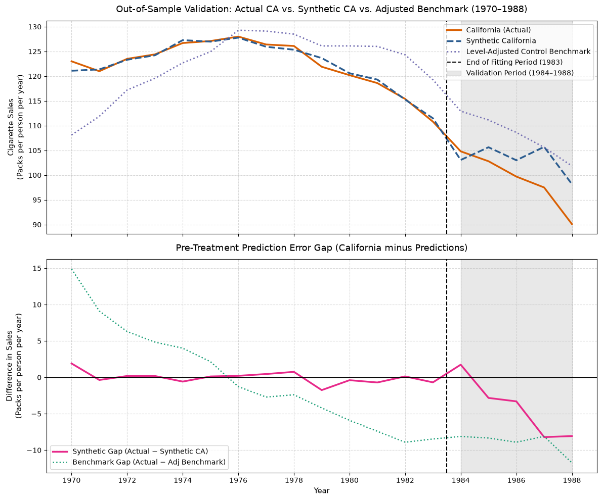
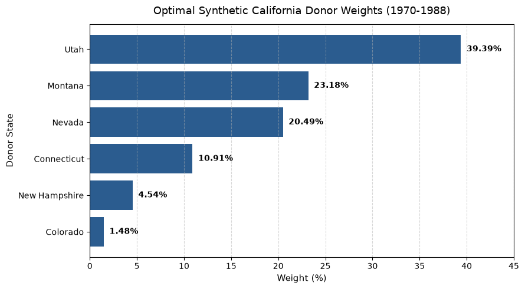
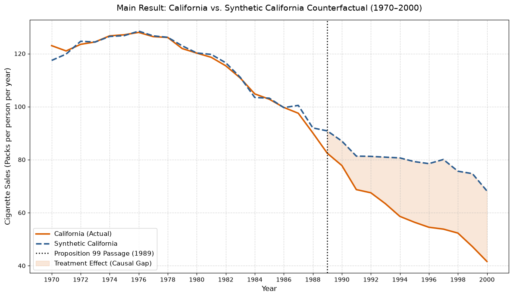
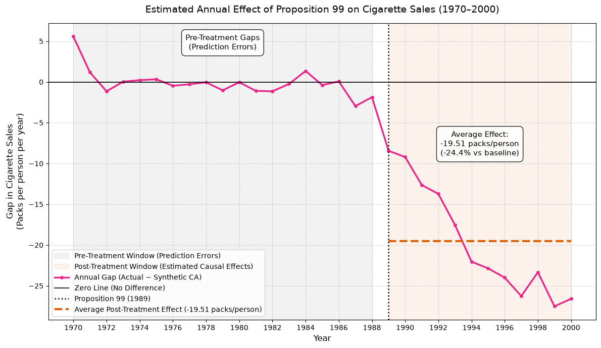
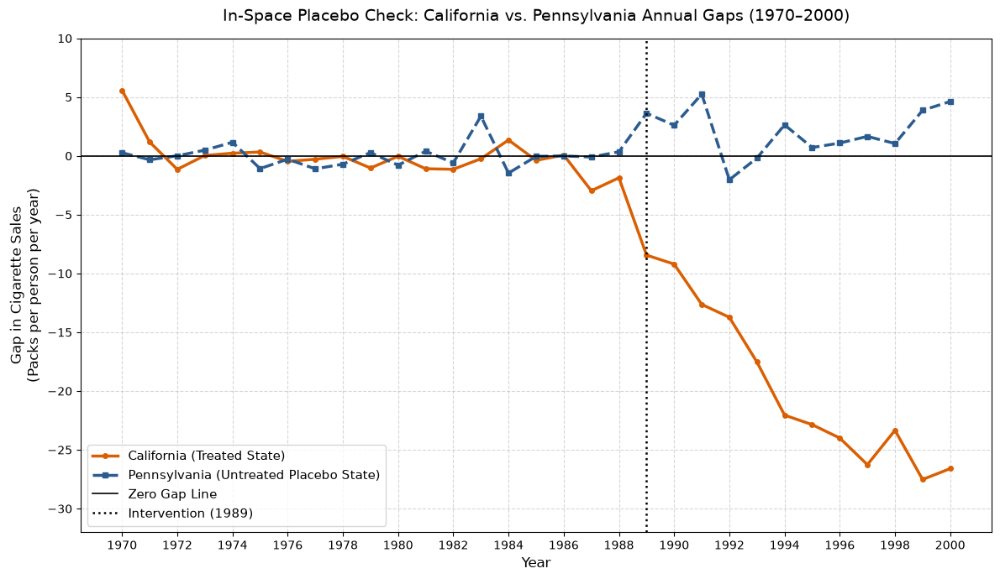

# Estimating the Causal Impact of Proposition 99

## The question

In 1989 California passed "Proposition 99", a big tobacco control law. The question is simple: did it actually reduce cigarette sales? We can't see what California would have looked like without the law, so we build it using other states.

## The data

Yearly cigarette sales (packs per person) for 39 states from 1970 to 2000. California is the treated state, the other 38 are the donor pool. The data is clean, no missing values and no duplicates. Pre-treatment period is 1970-1988 (19 years) and post-treatment is 1989-2000 (12 years).

## The starting position

California sits on the lower side of the dense region of the other states and it is already declining before the law. So a simple average of all states is not a good comparison, the gap just keeps getting bigger.

## Synthetic California

The idea is to give different weights to the donor states so that their mix reproduces California before 1989. Weights are not negative and sum to 1. 

First I trained the weights on 1970-1983 and tested on 1984-1988. It fit well in training (RMSE 0.81) but got worse on validation (RMSE 5.56), because the real California started to fall faster in the late 80s. Still, it was better than the level-adjusted average benchmark (RMSE 9.15), so I decided to refit on the whole pre-period (1970-1988).

The final model has an RMSE of 1.66 packs per person. Utah, Montana and Nevada have the biggest influence.

## Results

After 1989 real California goes clearly under synthetic California, and the gap keeps growing.

The gap plot shows it more clearly. Before 1989 the differences are around zero, after that they go down fast.

- Average effect (1989-2000): **-19.51 packs per person per year**
- Relative to the counterfactual: **-24.4%**
- Effect in 2000: **-26.60 packs per person**

## Bonus: placebo check

To see if this is just luck, I ran the same method on Pennsylvania, a state with almost the same pre-treatment average as California and no law. Its post/pre error ratio is 8.11, while California's is 154.75. So the California drop is much bigger than what the method produces by chance.

## Caution

The validation showed that California was already going down before 1989, so part of the gap can be this earlier trend and not only the law. The real effect is probably a bit smaller than -19.5, but the result is still strong.
